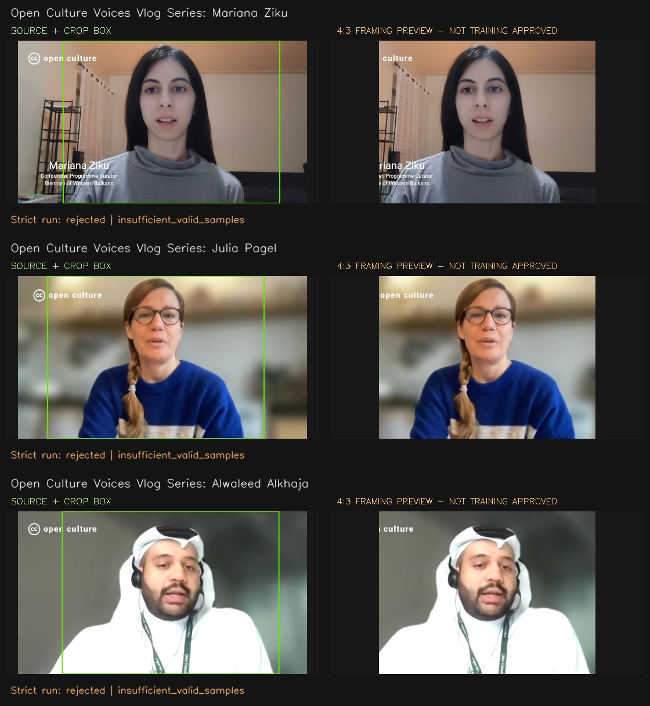

# Three-video framing pilot

Small, deliberately checked-in previews from the 2026-10-21 pilot. No HTML,
full-length originals, detector weights, duplicate WAV files or training data are
included. Other generated artifacts remain ignored under `data/`.

- [45-second compilation](compilation.mp4)
- [Mariana: 15-second preview](mariana.mp4)
- [Julia: 15-second preview](julia.mp4)
- [Alwaleed: 15-second preview](alwaleed.mp4)
- [Machine-readable provenance](manifest.json)



## What these demonstrate

These are **framing previews, not successful strict-filter outputs or approved
training samples**. The default pipeline rejected all nine 15-second candidates,
primarily because its requested torso region extended below these close-up
webcam frames. The default acceptance settings were not loosened.

The separate previews preserve the available source height, use a fixed 960 x
720 crop centered from median detected face positions, and resize to 768 x 576.
They show heads, shoulders and upper chest, not full torsos. Source logos/text
and visual defects remain; footage was not inpainted or enhanced. Audio and video
were trimmed together. Individual clips retain source frame timing; the viewing
compilation concatenates the three previews at a nominal 25 FPS.

## Reproduce without HTML

Use the isolated environment described in the parent README. These commands
download the complete source videos explicitly; the reproduction command itself
has no network access, verifies their hashes and only creates local media/JSON.

```bash
python -m data_fetching fetch --manifest data_fetching/examples/pilot_sources.jsonl --limit 3
```

Run the standalone preview recipe (the output directory must be new):

```bash
python -m data_fetching.reproduce_pilot --output data/facetime/pilot-reproduction
```

To repeat the strict rejection experiment separately, use:

```bash
python -m data_fetching models
python -m data_fetching process --manifest data_fetching/examples/pilot_sources.jsonl --limit 3 --scan-seconds 45 --max-clips 3
```

The source manifest preserves the original pilot's conservative unknown license
field for cache compatibility. The publisher's subsequently verified media
license is documented below; training approval is still separate.

## Attribution and media license

The underlying videos are by **Creative Commons**, from the *Open Culture
Voices Vlog Series*, featuring the following speakers:

| Preview | Original title / speaker | Original source | Extracted interval | Crop x,y,w,h |
| --- | --- | --- | --- | --- |
| `mariana.mp4` | Open Culture Voices Vlog Series: Mariana Ziku | [YouTube](https://www.youtube.com/watch?v=PKfyqkIJQwY) / [publisher page](https://creativecommons.org/2022/05/06/episode-28-open-culture-voices-mariana-ziku/) | 00:25-00:40 | 200,0,960,720 |
| `julia.mp4` | Open Culture Voices Vlog Series: Julia Pagel | [YouTube](https://www.youtube.com/watch?v=CkV_xSfurrI) / [publisher page](https://creativecommons.org/2022/05/12/episode-30-open-culture-voices-julia-pagel/) | 00:55-01:10 | 130,0,960,720 |
| `alwaleed.mp4` | Open Culture Voices Vlog Series: Alwaleed Alkhaja | [YouTube](https://www.youtube.com/watch?v=AvXt8nVpYKk) / [publisher page](https://creativecommons.org/2022/03/10/episode-11-open-culture-voices-alwaleed-alkhaja/) | 00:40-00:55 | 196,0,960,720 |

Creative Commons explicitly identifies the series' videos as licensed under
[Creative Commons Attribution 4.0 International (CC BY 4.0)](https://creativecommons.org/licenses/by/4.0/)
in its [series retrospective](https://creativecommons.org/2023/12/15/celebrating-two-years-of-ccs-open-culture-voices/)
(verified 2026-10-21). The included video excerpts and source-derived imagery are
shared under that license. Retain attribution, license links and modification
notices when sharing these files. This notice applies to the sample media, not
as a new blanket license for the repository's code or unrelated material.

Modifications: temporal extraction, 4:3 cropping, resizing, encoding and audio
resampling; compilation concatenation and frame-rate standardization; source
screenshots annotated and arranged into a comparison image. The speakers and
Creative Commons do not endorse this project. Other rights, including privacy
and publicity rights, are not automatically resolved by this copyright license;
this demo does not constitute approval for model training or impersonation.

The original pilot metadata conservatively left permissions unknown. The
publisher's series-level statement was located before publishing this bundle;
the manifest records this evidence without changing training-approval status.
